<div align="center">

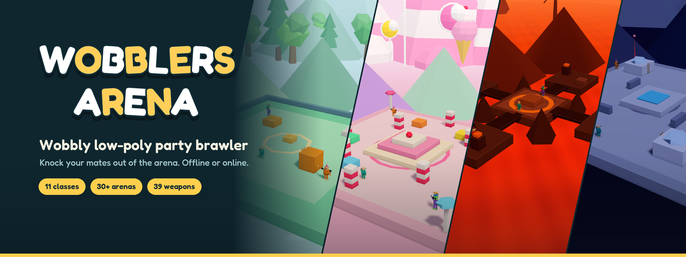

<br />

[](https://testflight.apple.com/v1/app/6833812750)


</div>

## About the game

**Wobblers Arena** is a third-person party brawler where blocky, wobbly fighters knock each other around small low-poly arenas. Weapons drop from the sky in crates, every hit sends someone ragdolling, and the floor itself may tilt, quake or drift under your feet.

Play offline against computer players, open a room and play online with friends using a public room or a code, or team up for the Arcade boss rush in two-player co-op. Matches are short, a round takes a few minutes, and the game is built for phones in landscape as much as for a keyboard and mouse.

<div align="center">
  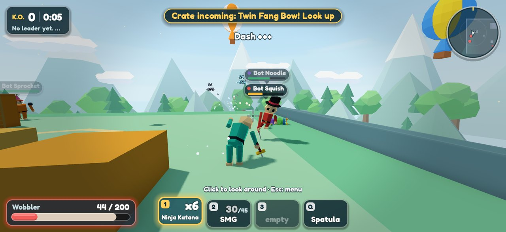
  <em>A Classic match on Sunny Arena: crates drop from the sky, and whoever grabs the weapon first gets the swing.</em>
</div>

## What's new in 0.4.0

The co-op update, as it appears in the game's What's new card:

- **Arcade co-op.** Two players online beat the six-stage boss rush together, and a bot takes over if your mate leaves.
- **Quick play.** One tap on the title screen for a random arena and mode, straight into an offline match.
- **A new title screen.** Play and Quick play on the left, the rest on the right.
- **A fairer start.** Matches open with a countdown, and you spawn on a random safe spot.
- **Fixed.** Melee Arcade bosses, and the FIRE button that could stick.

## What's in it

- **11 classes.** Five to start with (Wobbler, Bruiser, Scamp, Gramps and Zorp) and six more to buy or unlock by playing. Each has its own health, speed, jump and knockback.
- **39 weapons.** A spatula, bats, mallets and katanas; shotguns, snipers and miniguns; rocket and cluster launchers; and odd ones like the Net Gun, Snake Shooter and Twin Fang Bow.
- **30+ arenas.** A sunny arena, an ice rink, a volcano rim, a moon base, a candy land, a pirate ship, a haunted hollow and many more, plus a Sandbox where you build your own from blocks.
- **20+ game types.** Classic, Melee Only, Guns Only, Ninja, Explosive, Weapon Ladder, Deathmatch, Sudden Death, team games from 1v1 to 5v5 Chaos, low-gravity Moon Drift and a Practice Range.
- **Moving floors.** Pick Steady, Wobble, Tilt, Quake or Drift for any arena, or leave it on Random.
- **Breakable props.** An optional offline setting makes about half of each arena's cover breakable; broken pieces burst into debris and respawn about two minutes later.
- **Offline and online.** Computer players in four difficulties, and online rooms for up to 8 players. The Godot game and the web game can play in the same room.
- **Quick play.** One tap for a random game type, arena, class and floor, straight into an offline match.
- **Arcade co-op.** Two players online take on the boss rush together, and a bot holds the seat if your partner leaves.
- **Kids mode.** An offline assist with gentle auto-aim and an edge guard, for half the coins and no leaderboard score.
- **Leaderboards.** Top K.O.s, wins and Arcade runs live on the server, in the Account sheet.
- **Walldrobe and Shop.** Earn coins from matches and daily goals, then spend them on outfits, hats, colours, emotes and classes.
- **Replays.** A short slow-motion replay of each K.O.
- **Six languages.** English, 繁體中文, 简体中文, 日本語, Français and Español.

## Screenshots

<table>
  <tr>
    <td width="50%">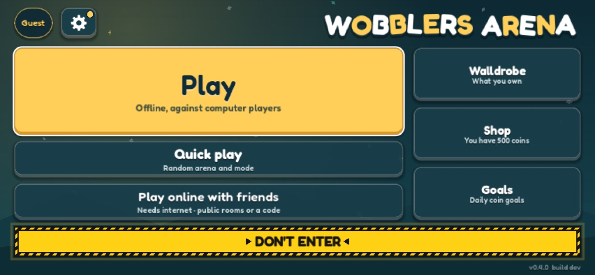<br /><sub>Title screen: Play and Quick play on the left, the Walldrobe, Shop and Goals on the right.</sub></td>
    <td width="50%">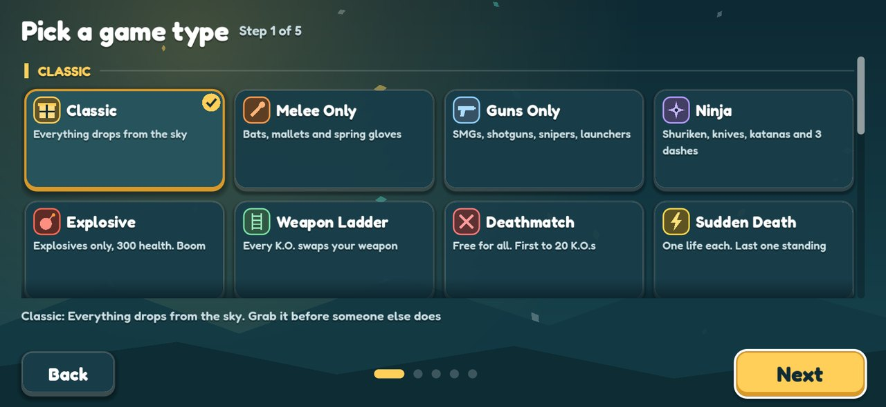<br /><sub>Pick a game type.</sub></td>
  </tr>
  <tr>
    <td>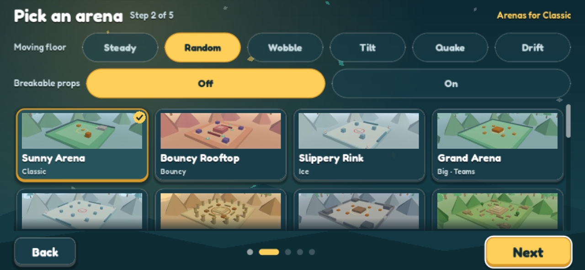<br /><sub>Pick an arena, how its floor moves, and whether its props break.</sub></td>
    <td>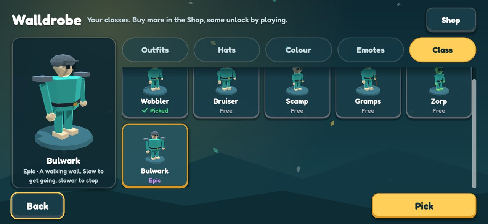<br /><sub>The Walldrobe: classes, outfits, hats, colours and emotes.</sub></td>
  </tr>
  <tr>
    <td>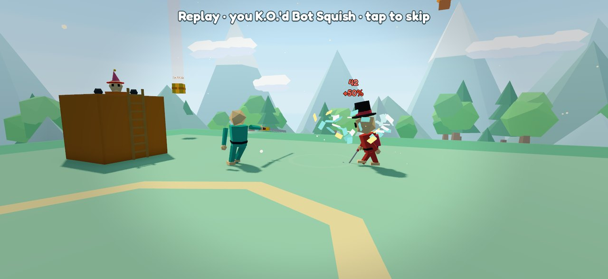<br /><sub>Slow-motion replay of a K.O.</sub></td>
    <td>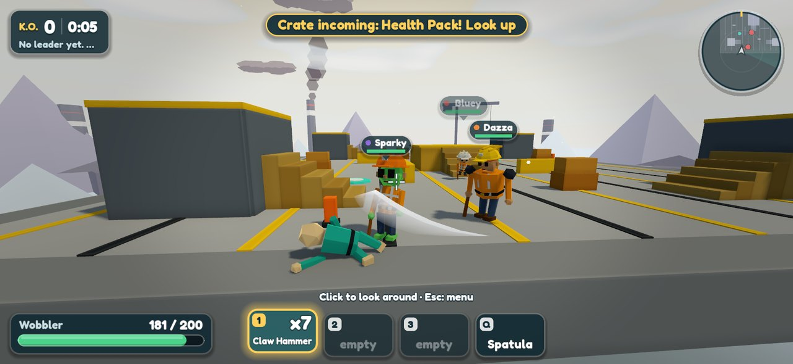<br /><sub>Construction on Site Yard, fought with tradie tools.</sub></td>
  </tr>
</table>

## Arenas

<table>
  <tr>
    <td width="33%">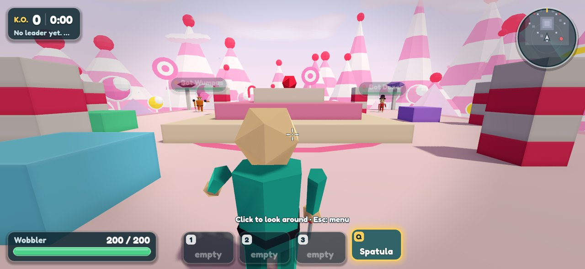<br /><sub>Candy Land</sub></td>
    <td width="33%">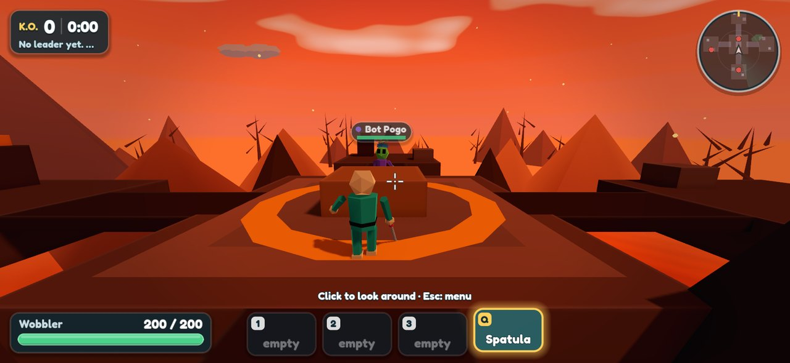<br /><sub>Volcano Rim</sub></td>
    <td width="33%">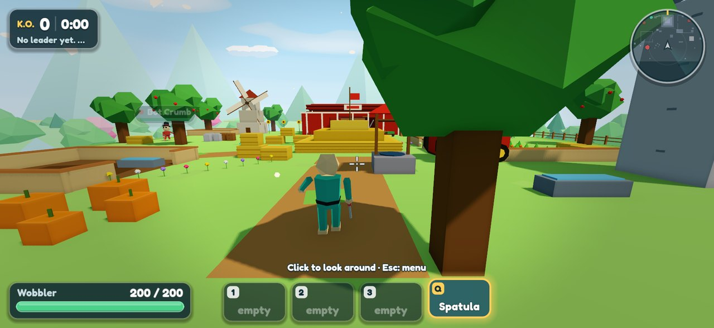<br /><sub>Sunny Farm</sub></td>
  </tr>
  <tr>
    <td>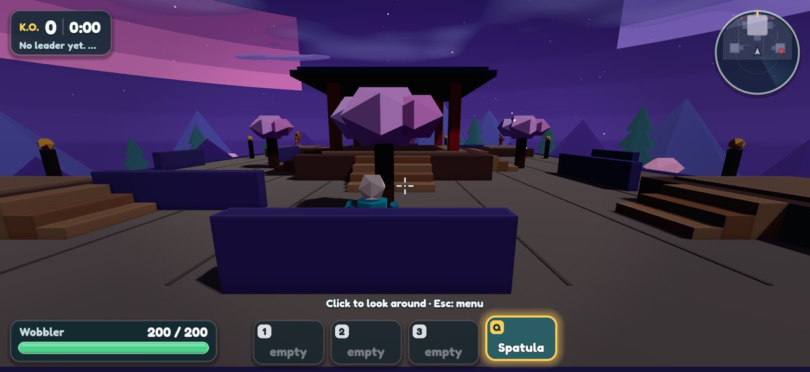<br /><sub>Moonlit Dojo</sub></td>
    <td>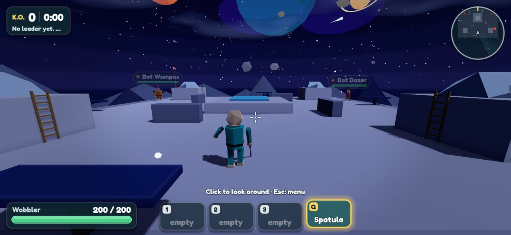<br /><sub>Moon Base</sub></td>
    <td>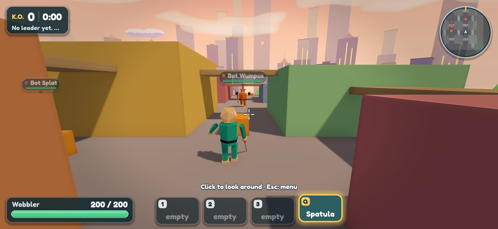<br /><sub>Rooftops</sub></td>
  </tr>
</table>

## Classes

<div align="center">
  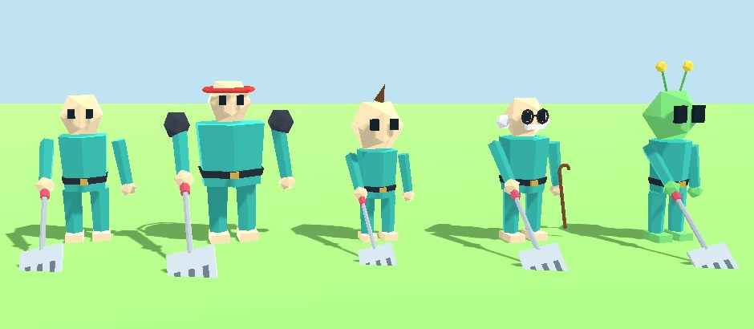
</div>

| Class | In the game's words |
| --- | --- |
| **Wobbler** | Balanced. No surprises, just wobbles |
| **Bruiser** | Big, slow, hard to shove. Hugs hurt |
| **Scamp** | Tiny and zippy. Flies like a frisbee |
| **Gramps** | Sharp steering, quick reloads. Back in my day… |
| **Zorp** | Fragile, floaty, great tech. Comes in peace, mostly |

Six more are in the Shop or unlock as you play: **Bulwark**, **Zippy**, **Ace**, **Boo**, **Champ** and **Rampage**.

## Construction and Arcade

Behind the DON'T ENTER sign on the title screen is the Construction set: a worksite arena, nine tradie weapons (Pipe Wrench, Nail Gun, Jackhammer, Spirit Level, Tape Measure, Cement Bucket, Cone Launcher, Angle Grinder and Cordless Drill) and **Arcade**, a six-stage boss rush. Fight through the Tradies, the Engineer, the Designer, the Supervisor and the Project Manager to reach The Client, on Easy, Normal or Nightmare. Arcade runs solo offline, or two-player co-op online.

## Play it

- **iPhone and iPad:** join the [TestFlight beta](https://testflight.apple.com/v1/app/6833812750).
- **Mac, Windows, Android and Web:** build from source for now. See below, [docs/BUILD_ANDROID.md](docs/BUILD_ANDROID.md) and [docs/BUILD_IOS.md](docs/BUILD_IOS.md).

## Run from source

You need [Godot 4.7](https://godotengine.org/download) and, for the server and tests, Node 18 or newer.

Run the game:

```bash
godot --path godot
```

Run the room server for online play (a room list and message relay, on Node):

```bash
npm install
```

```bash
npm start
```

Run the checks. `npm test` covers content, translations, maps and the server; the `test:godot-*` scripts drive the Godot game itself, for example:

```bash
npm test
```

```bash
npm run test:godot-combat
```

## What's in this repository

| Path | What it is |
| --- | --- |
| [`godot/`](godot) | The game, in Godot 4.7 (GDScript) |
| [`shared/`](shared) | Classes, weapons, arenas and game types as JSON, shared by every client |
| [`server.js`](server.js), [`accounts.js`](accounts.js) | Room list, message relay and accounts |
| [`index.html`](index.html), [`public/`](public) | The original web game |
| [`tools/`](tools) | Tests, content export and screenshot scripts |
| [`docs/`](docs) | Design and build notes |

Good places to start reading: the [Roadmap](docs/ROADMAP.md), the [Codemap](docs/CODEMAP.md), the [Godot architecture](docs/GODOT_ARCH.md) and the [network protocol](docs/PROTOCOL.md).

The screenshots on this page are rendered from the game by the scripts in `tools/shoot-godot-*.sh`.
