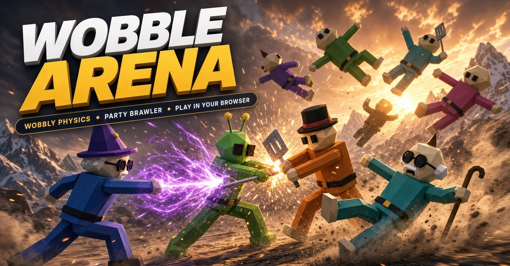
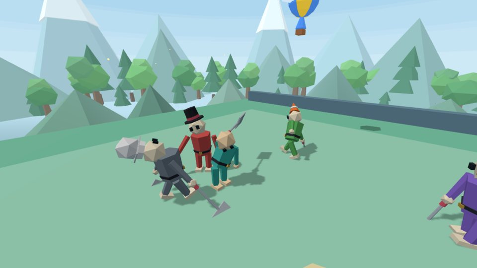
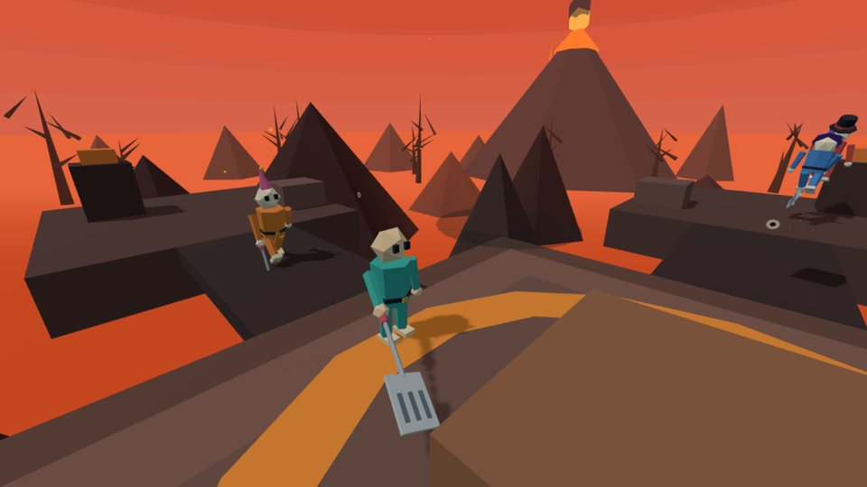
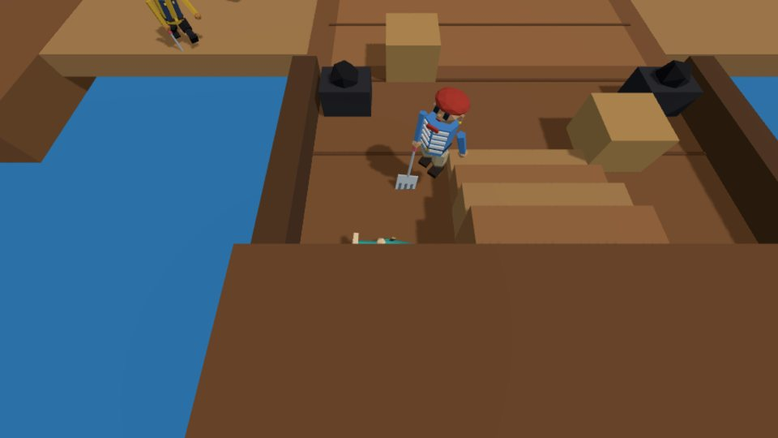
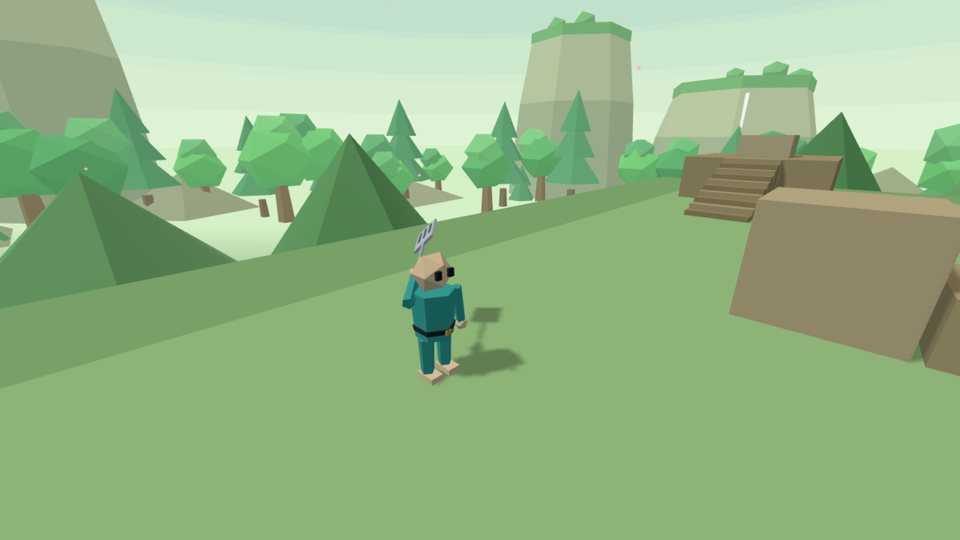
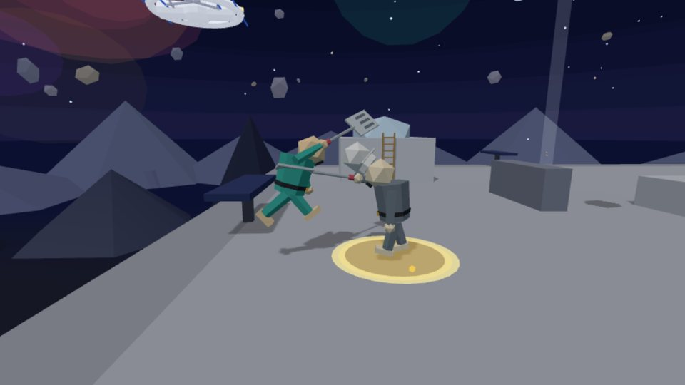
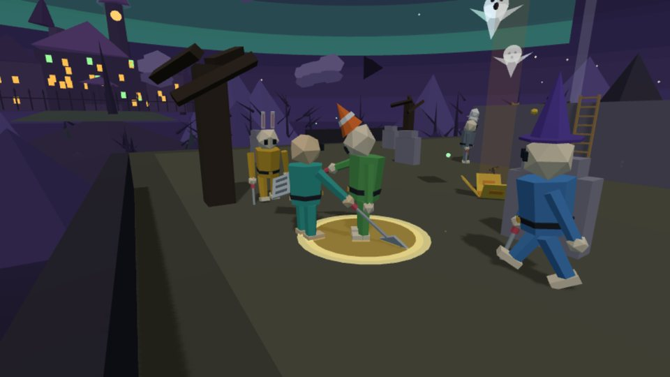
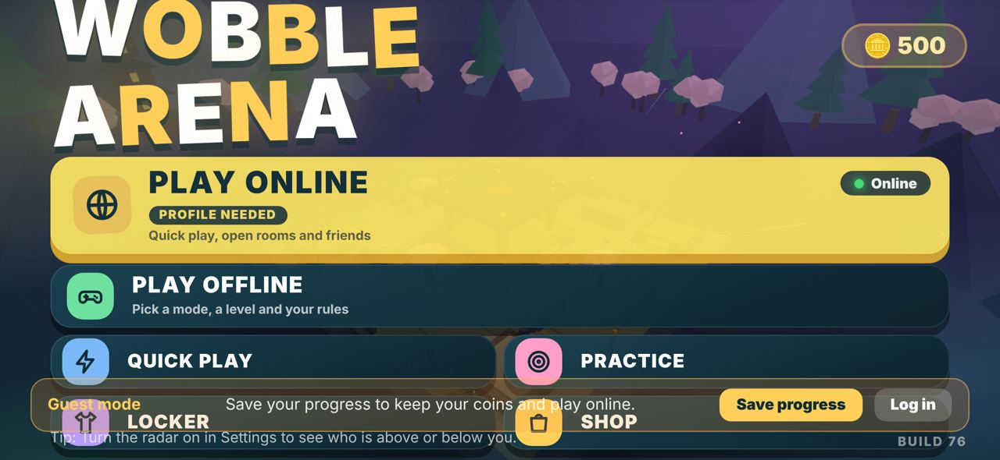
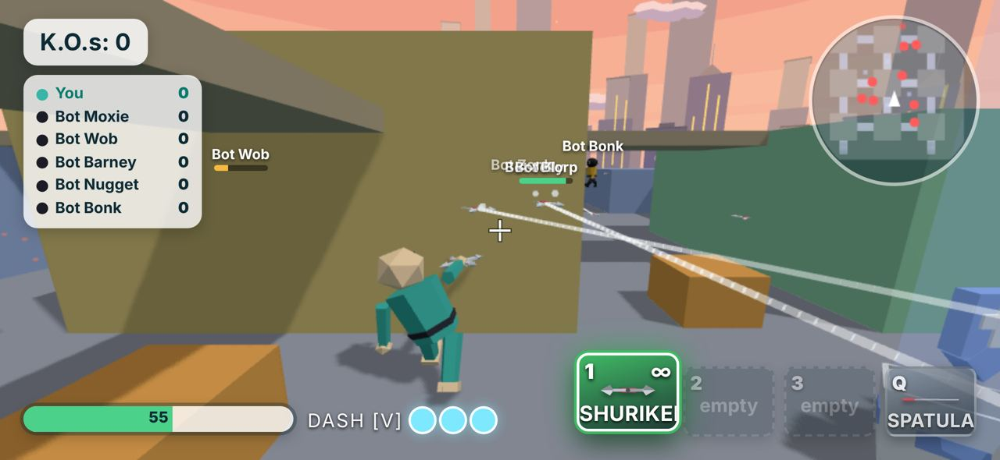
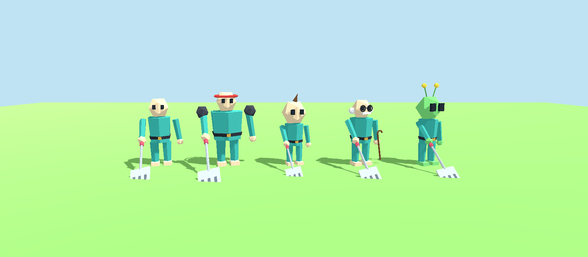

<p align="center">
  
</p>

<p align="center">
  <b>Bonk your friends off floating arenas.</b><br>
  A chaotic, wobbly-physics party brawler. Play free in your browser today.<br>
  iPhone, Android & PC apps coming soon — same rooms, same chaos.
</p>

<p align="center">
  
  
  
  
</p>

---

## The Game

You’re a floppy, spring-limbed wobbler. Fight on floating maps with open edges. Weapons rain from the sky. Every hit sends bodies flying.

**Knock everyone else off. Or fall trying.**

Play solo against bots, practise weapons, or jump into online rooms with up to 8 friends. Works on desktop and phone (touch controls included).

## Screenshots

<table>
  <tr>
    <td><br><sub><b>Sunny Arena</b></sub></td>
    <td><br><sub><b>Volcano Rim</b></sub></td>
  </tr>
  <tr>
    <td><br><sub><b>Pirate Ship</b></sub></td>
    <td><br><sub><b>Temple Ruins</b></sub></td>
  </tr>
  <tr>
    <td><br><sub><b>Moon Base</b></sub></td>
    <td><br><sub><b>Haunted Hollow</b></sub></td>
  </tr>
</table>

<p align="center">
  
  
</p>

## Pick Your Wobbler

| Class | Vibe | Superpower | Trade-off |
|---|---|---|---|
| **Wobbler** | Balanced | Reliable all-rounder | None |
| **Bruiser** | Heavy tank | +30% health, hits harder | Slow & clumsy in air |
| **Scamp** | Tiny & zippy | Fastest, great air control | Fragile |
| **Gramps** | Precision | Sharp steering, fast reloads | Lower top speed |
| **Zorp** | Alien tech | Guns 20% faster, more ammo | Lowest health |

<p align="center">
  
</p>

## What’s Inside

- **15 modes** — Classic, Melee, Guns, Ninja, Explosive, Giant, Mega Damage, Weapon Ladder, Pillars, team fights (1v1–4v4), Sandbox…
- **33 maps** — Sunny Arena, Volcano Rim, Pirate Ship, Moon Base, Haunted Hollow, Candy Land and more
- **30 weapons** — Bats, spring gloves, shotguns, rockets, flamethrowers, katanas, boomerangs…
- **Bots** on Easy → Insane
- **Online rooms** + room codes
- **Cloud save**, locker, shop, practice range
- **Cross-play** between browser and native clients (in progress)

## Platforms

| Platform | Status |
|---|---|
| **Browser** | Playable now |
| **iPhone** | Offline + guest online ready. TestFlight next |
| **Android** | Same Godot build; APK/AAB export ready (`docs/BUILD_ANDROID.md`) |
| **PC** | After phones |
| **Godot web** | Coming once native reaches parity |

## Play It

```bash
npm install
npm start
```

Open http://localhost:3000 → Play online → Quick play.

---

**Developers:** Full server setup, protocol, roadmap, tests and architecture live in [`docs/`](docs/).  
See [`docs/ROADMAP.md`](docs/ROADMAP.md) for the native client plan.
