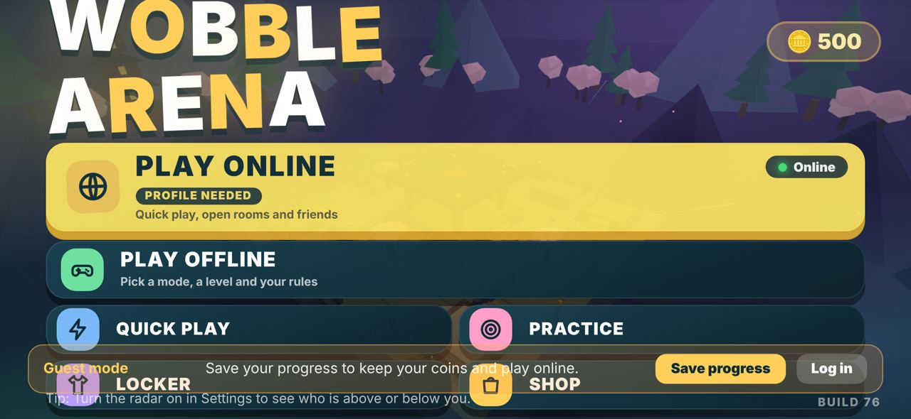
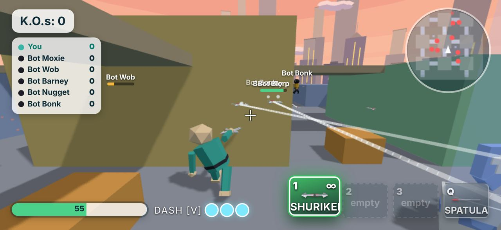

# Wobblers Arena → iOS: Review, Plan & Design

_Status: superseded by docs/ROADMAP.md (one Godot codebase for iOS, PC and web). The review in sections 2-3 is still accurate for build b76._

---

## 1. Executive summary

Wobblers Arena already has the hard part done: a fun, content-rich wobbly-physics brawler. It has about 12 modes, about 31 maps, about 29 weapons, bots with 4 difficulties, cosmetics, accounts, cloud save, online rooms and a kill-cam. The market also has a gap: **no major wobbly-physics party brawler is native on iOS yet**. Party Animals mobile is announced but has no date.

**It cannot ship to iOS as it is today.** Five blockers:

1. **It can't be played on a phone.** Touch controls were removed in build 68, and starting play requires Pointer Lock, which iOS doesn't support.
2. **It can't start offline.** three.js and PeerJS load from CDNs, and the server address is derived from `location.host`.
3. **It's too heavy for a phone.** The default quality is High: shadow map 2048, antialias, pixel ratio 2, no shared materials, few `dispose()` calls.
4. **The economy can't be monetized.** `coins_####` gives unlimited coins, everything runs on the client, and there's no In-App Purchase.
5. **It's missing App Store policy items.** There's no report/block for chat and names (guideline 1.2), a free shared TURN server is hard-coded, and there's no privacy manifest.

**Original recommendation** was Capacitor (WKWebView) first. **Decision (§6): a native rewrite in Godot 4 instead**, which keeps cross-play with the web version. Blockers 1–3 go away in the native client because it gets new touch input, ships its own assets and has a configured server URL. Blockers 4–5 and the netcode issues still apply, and they now matter more, because the server protocol becomes a shared contract between two clients.

---

## 2. Review

### 2.1 What's good
- **Lots of content:** modes, maps, weapons, outfits, emotes, daily gift, levels/XP, stats, match analysis, kill-cam replay.
- **Synthesized audio** (WebAudio, no files), so the app stays small.
- **Built to survive problems:** a crash guard, a backup save, recovery after a graphics reset, automatic resolution scaling, Low/Med/High quality.
- **Solid server.** Accounts use salted scrypt hashes, rate limits, recovery codes and account deletion (deletion is required by App Store 5.1.1(v)). There's a compressed static cache, a build-version gate on rooms, and host migration.

### 2.2 iPhone check (Playwright, iPhone 15 Pro landscape 852×393)

| Main menu | In match |
|---|---|
|  |  |

What these show:
- **Main menu:** the title is cut off at the top. The "Guest mode" bar sits on top of Locker and Shop, and the tip text overlaps the buttons. The layout is a desktop grid that doesn't fit a 393pt-tall screen.
- **In match:** the HUD shows keyboard hints (`DASH [V]`, `Q`, `1`) and there are no touch controls at all. The weapon label is clipped ("SHURIKE…"), name tags overlap, and the scoreboard takes about 25% of the screen.

### 2.3 Problems, by severity

| # | Severity | Problem | Where |
|---|---|---|---|
| 1 | **Blocker** | No touch input in b76, and play is gated on `requestPointerLock`. The touch layer still exists in the stale root `index.html` (b66). | `public/index.html` ~7428, 8856, 9686 |
| 2 | **Blocker** | three.js loads through an import map from jsDelivr, and PeerJS from 5 CDNs. The game won't start offline or in a bundled app. | 1301, 8167 |
| 3 | **Blocker** | `SERVER_URL` is empty, and the API and WebSocket addresses come from `location.host`, which becomes `capacitor://localhost` in a wrapped app. | 8259–8275 |
| 4 | High | `redeem()` turns `coins_<n>` (up to 9999) into coins, as often as you like. Fine for testing, fatal once coins can be bought. | 4399 |
| 5 | High | Netcode: the host relays guest messages without stamping who sent them, so a guest can fake the sender, claim any amount of damage, or end the match (`pend`). | 8422, 8617–8624 |
| 6 | High | Chat and player names have mute only. App Review 1.2 needs report, block, a filter and contact info. | 8616 |
| 7 | High | The free public "openrelay" TURN credentials and the PeerJS cloud are used as production infrastructure. | 8176 |
| 8 | Medium | The roster from the host is rendered with an unescaped `color` field, so a malicious host can inject HTML. | 8237 |
| 9 | Medium | GPU memory leak risk: about 160 places create meshes, there's a new material per mesh, and only 11 `dispose()` calls. Repeated map loads and the menu turntables grow memory. That's dangerous under iOS memory limits. | 1437, `loadMap`, `TT` |
| 10 | Medium | Too heavy by default for phones: High preset, 2048 shadow map, `antialias`, DPR up to 2. Auto-resolution only runs while Pointer Lock or a network match is active, so it never runs on touch devices. | 1323, 1416, 9727 |
| 11 | Low | No `viewport-fit=cover` or safe-area insets, `100vh` instead of `100dvh`, no orientation lock. | line 6, 628 |
| 12 | Low | Audio isn't resumed after an iOS interruption (a call, Siri), and saves and the login token live only in localStorage, which iOS can clear. | 1354, 7881, 8028 |
| 13 | Housekeeping | The root `index.html` is a stale b66 duplicate. Delete it once the touch code has been ported. | `/index.html` |

### 2.4 Architecture
- **One 929 KB file:** a single module, about 400 top-level functions, global mutable state, no build step, tests or lint. Changelog HTML and "build N" CSS patches have piled up inline.
- **What that costs:** this is fine for a solo web prototype, but it's the biggest risk to shipping native features (IAP, Game Center) and regular live updates.
- **Physics** is hand-rolled: AABB collision plus spring-driven limbs, not a real ragdoll. That's fine and cheap, and it keeps the "wobble" feel without a physics library.
- **Server:** one process with rooms in memory. Fine for launch. It needs a region plan and a paid always-on host; Render's free tier sleeps.

---

## 3. Market and trend fit (late 2026)

What the leaders do (sources are in the research brief, summarized here):

| Pattern | Who | What it means for Wobblers Arena |
|---|---|---|
| 2–5 minute sessions, rotating modes | Stumble Guys, Brawl Stars | Matchmaking straight from Play, a **mode-of-the-hour rotation**, rounds of 3 minutes or less |
| Cosmetics-only, no pay-to-win | All leaders | Keep weapons free. Sell outfits, hats, emotes, KO effects, trails |
| Season pass about $5–10 | Brawl Pass about $8.99; Brawl Stars revenue rebounded in 2026 after reworking its pass | **Wobble Pass**: free plus premium track, 6-week seasons |
| Daily and weekly quests | Universal | Replaces the plain "daily gift" with 3 dailies and a weekly chain |
| UGC / map maker | Eggy Party (100M+ user maps), Stumble Workshop | We already have a **Sandbox block builder**. Grow it into "Wobble Workshop" in a later phase (needs 1.2 moderation) |
| Creator codes, licensed or themed crossovers | Stumble Guys | Later. Creator codes are cheap to add to the existing `redeem()` flow (server-checked) |
| Live-ops is what keeps a game alive | Squad Busters shuts down Dec 2026 despite Supercell backing | Plan a content cadence before launch, not after |
| Ranked mode | Stumble Guys, Brawl Stars | Trophy road first. Ranked comes once there are enough players |

**Positioning:** "_The wobbly party brawler you can play in 3 minutes, with your friends, on your phone._" Lead with the physics comedy (funny KOs, kill-cam clips you can share) instead of competing on battle-royale size.

**Payments:** coins and cosmetics must use Apple IAP (consumables or non-consumables, with the pass as a non-renewing purchase). US external purchase links currently carry 0% commission, but the court case is still open. Treat a web shop as an optional extra, not the plan. **No loot boxes.** If you add random items, 3.1.1 requires showing the odds.

---

## 4. Design

### 4.1 Core loop (mobile)
```
Open app → (Play) → matchmade 3-min round (bots fill instantly) → KO highlights + rewards
      ↑                                                                 ↓
  Locker / Shop ← coins, pass XP, quest progress ← trophies / level up ←┘
```
- **One-tap Play.** Bots fill empty seats right away, so nobody waits more than about 8 s. Humans replace bots between rounds.
- **Round length:** 3 minutes or 5 KOs. Matches are best of 3 rounds in party mode.
- **Rotation:** 3 featured modes at a time (e.g. Classic, Ninja, Moon Drift). The others are available in Custom or Private rooms.

### 4.2 Touch controls (the most important design work)
These are landscape controls in the style of Brawl Stars and Stumble Guys, re-using b66's touch layer as the starting point:

```
┌──────────────────────────────────────────────────────────────┐
│ [≡]  KOs 2 · 1:42                    🏆 Leader: Moxie  [map] │
│                                                              │
│                                                  (Grab)      │
│   ( floating                                  (Jump)  (Dash) │
│     move stick )                           ( ATTACK / aim )  │
│                          [1][2][Q]                           │
└──────────────────────────────────────────────────────────────┘
```
- **Movement:** a floating left stick that appears where the thumb lands. The camera follows automatically, and dragging on the right half of the screen looks around.
- **Attack button doubles as aim:** tap to swing or shoot at the nearest target (aim assist), or drag to aim yourself and release to fire. This is the Brawl Stars convention.
- **Weapon slots:** the hotbar becomes 3 compact icons with no keyboard hints. Hide hints whenever the last input was touch.
- **Haptics:** light on a hit, heavy on a KO, selection ticks in menus (native haptics through a Godot iOS plugin).
- **Accessibility:** left-handed swap, button size and opacity sliders, Reduce Motion (already exists), and aim-assist strength.
- **Controllers:** MFi and PlayStation/Xbox controllers through Godot's built-in joypad input. It's cheap to add and on-trend.

### 4.3 HUD and menus for a 393 pt tall screen
- **HUD:** collapse the scoreboard into a top-centre pill (your KOs, the timer, the leader). The full table appears on hold or at round end. Cap name tags to 3 at a time and fade the far ones.
- **Main menu:** a big **PLAY** button with the current-mode carousel at the bottom right. Coins, gems, pass and profile go along the top bar. Locker, Shop, Pass, Friends and Settings go in a left rail. That gives the menu one clear focus and stops the overlap bugs.
- **Guest banner:** make it a small chip instead of a full-width bar.
- **Layout fixes:** `viewport-fit=cover`, `env(safe-area-inset-*)` padding, `100dvh`, and orientation locked to landscape in the native shell.

### 4.4 Progression and economy
- **Coins** (soft currency) are earned by playing and spent on base cosmetics.
- **Gems** (hard currency) are bought with IAP and spent on premium cosmetics and the pass.
- **Wobble Pass:** 50 tiers, free and premium tracks, about $6.99, with a 6-week season and a theme (e.g. "Pirate Panic" using the existing pirate map and skins).
- **Quests:** 3 dailies (e.g. "KO 5 with the spatula") and a weekly chain.
- **Trophy road:** trophies are won and lost per match and unlock modes, maps and cosmetics. That's the main long-term goal for players.
- **All currency and grants are server-side.** The client asks and the server decides. Remove `coins_####` from release builds, keep it only behind the dev panel in dev builds, and move codes to the server.

### 4.5 Social
- **Game Center:** sign-in for identity, plus friends, leaderboards (KOs, trophies) and achievements. Game Center counts as Apple's own service, but if Google or other third-party sign-in is added, guideline 4.8 means also offering Sign in with Apple.
- **Party up:** invite links (Universal Links) and a 4-digit room code (already exists).
- **Quick-chat and emotes** as the default communication. Free-text chat is off by default for under-16s, with report and block on every name and message.
- **Kill-cam clip share:** export a 6-second clip to Photos or a share sheet. Shareable clips are free marketing.

### 4.6 Tech architecture target (revised: Godot 4 native)
```
iOS app (Godot 4, GDScript; iOS export via Xcode)
 ├─ Game: scenes for player, weapons, maps, modes; hand-rolled wobble physics ported 1:1 from JS
 ├─ Net: WebSocket client speaking the existing JSON room protocol (docs/PROTOCOL.md, to be written)
 ├─ Native: Game Center, StoreKit 2 IAP, haptics, Keychain (Godot iOS plugins)
 └─ WSS ──► Game server (Node, ws) ── Redis/Postgres          ◄── Web client (three.js, existing)
              ├─ accounts, wallet, inventory, IAP receipt validation (App Store Server API)
              ├─ room relay (existing), regional instances
              └─ live-ops config (rotation, shop, pass season) as JSON
```
- **Cross-play is the hard constraint.** In the current netcode one player's client is the host and the server only relays. A Godot host has to run the same simulation as a web host and send the same ~25 message types (`hello`, `welcome`, `roster`, `start`, `s`/`S` state, `h` hits, `ko`, `pend`, `crate(s)`, `chat`, `ping`/`pong`, `badver`…). So:
  - **Write the protocol down first** (`docs/PROTOCOL.md`) from `server.js` and `public/index.html`, with a shared **protocol version** in place of today's build-number gate. Web and iOS ship builds on different schedules.
  - **Port the physics, don't replace it.** Keep the AABB collision and spring-driven limbs, with the same constants and tick rate. Don't use Jolt ragdolls for gameplay; they would feel different and desync. Jolt is fine for cosmetic debris only.
  - **Content is data.** Move maps, weapons, modes and cosmetics out of JS code into shared JSON that both clients load, so they can't drift apart.
  - **Drop PeerJS for cross-play rooms.** The Godot client uses only the WebSocket relay. Over time, move authority from the host client to the server (it's already the relay), starting with damage clamps and match results.
- **Minimum device: iPhone 12 (A14).** Target 60 fps on iPhone 12 using Godot's Mobile renderer, with a Low tier for thermal fallback.

---

## 5. Roadmap (revised for Godot)

| Phase | Length (1 dev) | Goal | Key work | Exit criteria |
|---|---|---|---|---|
| **0. Contract** | 1–2 wk | Both clients can target one spec | `docs/PROTOCOL.md`; protocol version handshake; netcode security fixes on server and web (sender stamping, damage clamp, host-only `pend`, escape roster); extract content (maps, weapons, modes, cosmetics) to shared JSON; a headless protocol test bot in Node | The web game still works, and the test bot can join a room, move and get KO'd |
| **1. Godot vertical slice** | 4–6 wk | One map, one mode, cross-play | Godot project in `godot/`; the wobble character and physics ported; 3 weapons; Classic mode on 1 map; touch controls (§4.2); joins web rooms as a guest | An iPhone 12 player and a browser player finish a match together at 60 fps |
| **2. Host parity and content** | 6–10 wk | Feature parity | Godot can host web guests; all modes, maps and weapons from JSON; bots (4 difficulties); HUD and menus (§4.3); kill-cam; audio | Every mode playable in mixed rooms with either side hosting |
| **3. Store-ready** | 2–3 wk | Pass App Review | Game Center; quick-chat and emotes only (no free text on iOS); report and block on names; in-app account deletion; privacy manifest; remove `coins_` codes; paid server host and own TURN (or relay only) | Internal review checklist passed, TestFlight external beta |
| **4. Monetization and meta** | 3–4 wk | Retention and revenue | StoreKit 2 with server receipt validation; gems; Wobble Pass; quests; trophy road; server-side wallet | D1 ≥ 35%, D7 ≥ 12% in soft launch |
| **5. Soft launch, then global** | 4–6 wk, then ongoing | Tune and grow | 2–3 small markets; tune the economy; crash-free sessions ≥ 99.5%; 6-week seasons; Android from the same Godot project | KPIs met |

**Rough total to global launch:** about 6–8 months for one developer, about 4–5 with two. That's 2–3 months more than the Capacitor path, mostly in Phases 1–2.

---

## 6. Decisions (answered 2026-11-12)

| # | Question | Decision |
|---|---|---|
| 1 | Capacitor or native rewrite | **Native rewrite in Godot 4** (GDScript) |
| 2 | Monetization | **Cosmetics, Wobble Pass and gems** (IAP, no loot boxes) |
| 3 | Online scope at launch | **Friends and private rooms plus bots.** No public matchmaking at launch |
| 4 | Free-text chat | **Off at launch.** Quick-chat and emotes only |
| 5 | Minimum device | **iPhone 12 (A14) and newer** |
| 6 | Cross-play with web | **Yes.** The Godot client speaks the existing room protocol |

Because of decision 3, the one-tap "matchmade" Play in §4.1 becomes **Play vs bots instantly, or Create/Join a room**. Public matchmaking moves to post-launch.

Still open, but not blocking Phase 0: whether the web version also gets free-text chat turned off (simpler moderation for mixed rooms), and the bundle ID and Apple Developer account.

---

## 7. Immediate next steps (proposed PRs)
1. **PR A — Protocol spec:** `docs/PROTOCOL.md` documents every message type, its fields, who sends it and the host/relay rules; adds a `proto` version to `hello`/`welcome` alongside the build gate.
2. **PR B — Server and web netcode hardening:** the server stamps the sender, damage is clamped per weapon, `pend` is host-only, roster colours are escaped, and `coins_` works only in dev builds.
3. **PR C — Shared content data:** extract weapons, maps, modes and cosmetics from `public/index.html` into `shared/*.json`, loaded by the web client with no behaviour change.
4. **PR D — Godot skeleton:** a `godot/` project with iOS export preset, a WebSocket client that does `hello`/`welcome`/`ping`, and a test scene that joins a live web room as a spectator.
